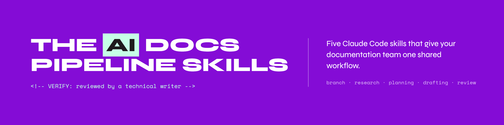

# AI documentation pipeline skills

This repo contains the five skills from the [AI Documentation Pipeline guide](https://zaycodes.com/resources#ai-doc-pipeline).
Copy them into your documentation repository and run them in order on a ticket.

Read the guide first. It explains how the stages connect and what you review at each one.

## What is in this repo

| Path | What it is |
|---|---|
| `.claude/skills/branch/` | Stage 0. Creates a feature branch named after the ticket |
| `.claude/skills/discover-feature/` | Stage 1. Researches the ticket and writes a research brief |
| `.claude/skills/plan-doc/` | Stage 2. Turns the brief into an outline for you to approve |
| `.claude/skills/draft-doc/` | Stage 3. Writes the draft, marking gaps and unverified content |
| `.claude/skills/doc-review/` | Stage 4. Lints, reviews, and runs a cold-reader check |
| `.claude/skills/doc-review/scripts/lint.py` | The mechanical lint script the review runs first |
| `.claude/templates/skill.md` | A blank skill for writing your own |
| `.claude/templates/CLAUDE.md` | A blank project instruction file. Copy it to your repository root and fill it in |

## Install

1. Copy the `.claude/` folder into the root of your documentation repository.
1. Restart Claude Code so it picks up the new skills.
1. Type `/` in Claude Code. The five skills appear in the list.

Using Cursor, Windsurf, or another agent? The skill files work as they are.
Only the folder location changes. See the guide, section 5.

## Configure before your first run

1. Copy `.claude/templates/CLAUDE.md` to the root of your repository and fill it in. In its third section, "Repository structure", list the folder your documentation lives in, for example `docs/` for a Docusaurus site. When `plan-doc` adds a new page, it puts it in that folder.
1. Fill in the CONFIG section at the top of `.claude/skills/doc-review/scripts/lint.py` with your team's style rules.

There are no paths to replace. The skills use Claude Code's folders (`.claude/skills` and `.claude/workspace`) and find your default branch themselves. Using another agent? Replace `.claude/` with your tool's folder in one find-and-replace across the skill files.

## Connect your tracker

`discover-feature` fetches tickets through an MCP server (Jira, Linear, GitHub Issues),
a CLI such as `gh`, or, with no setup at all, you paste the ticket or point to a file.
See the guide, section 3, for details.

## Run it

Run the skills in order on one ticket:

```
/branch DOC-1234
/discover-feature DOC-1234
/plan-doc DOC-1234
/draft-doc DOC-1234
/doc-review DOC-1234
```

Each stage saves its output to `.claude/workspace/DOC-1234/` and stops for you to review before the next one.
If a stage's input is missing, the skill stops and tells you which stage to run first.

### Review any page without a ticket

`doc-review` also works on its own. Pass a file path instead of a ticket ID:

```
/doc-review docs/path/to/page.md
```

| You pass | What it reviews | Stops if a stage is missing? | Where the review goes |
|---|---|---|---|
| A ticket ID | The draft named in that ticket's `plan.md` | Yes | `.claude/workspace/DOC-1234/review.md` |
| A file path | That file | No | The conversation |

## License

MIT. See `LICENSE`.
